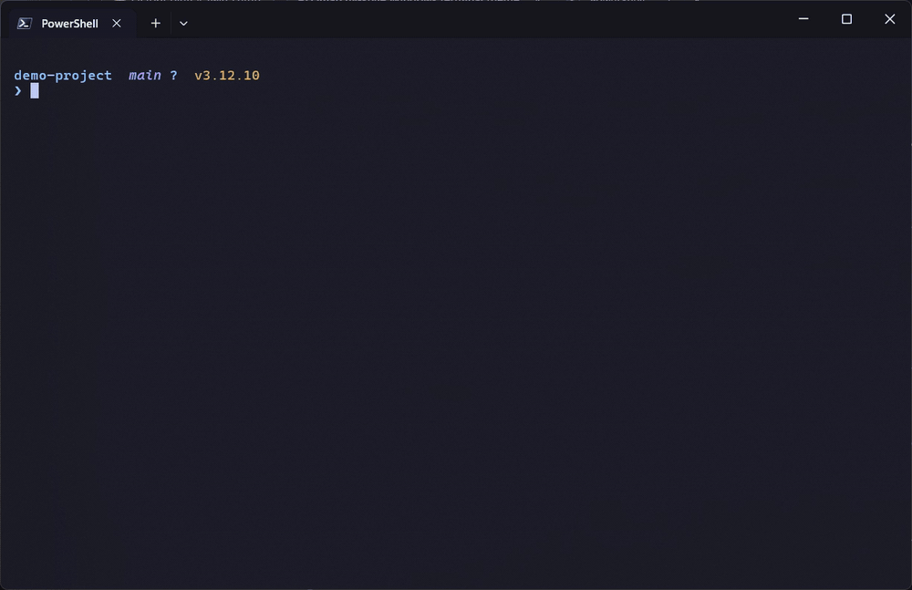

# terminal-setup

Omarchy-style terminal on Windows, Linux and macOS: Tokyo Night colors, CaskaydiaMono Nerd Font,
Starship prompt, Linux-style commands, lazygit, lazydocker and LazyVim.
On Windows it also sets up [GlazeWM](https://github.com/glzr-io/glazewm) so windows tile like Omarchy's
Hyprland, with gaps, Tokyo Night borders, a slim top bar and the same Super-key shortcuts.



## Install

One command, no cloning needed.

**Linux / WSL**
```bash
bash -c "$(curl -fsSL https://raw.githubusercontent.com/andyanalog/terminal-setup/v1.0.0/setup-linux.sh)"
```

**macOS**
```bash
bash -c "$(curl -fsSL https://raw.githubusercontent.com/andyanalog/terminal-setup/v1.0.0/setup-macos.sh)"
```

**Windows** (in PowerShell)
```powershell
iwr -useb https://raw.githubusercontent.com/andyanalog/terminal-setup/v1.0.0/setup-windows.ps1 -OutFile "$env:TEMP\setup-windows.ps1"; powershell -ExecutionPolicy Bypass -File "$env:TEMP\setup-windows.ps1"
```

Then: reopen Windows Terminal (Windows), open a new terminal (Linux), or open the Ghostty app (macOS).

These commands point at the `v1.0.0` release, so the script you run never changes underneath you. Prefer to read it first? Open the link in your browser, or clone the repo and run it locally:

| System | Run from the repo folder |
|---|---|
| Windows | `powershell -ExecutionPolicy Bypass -File .\setup-windows.ps1` |
| Linux / WSL | `bash setup-linux.sh` |
| macOS | `bash setup-macos.sh` |

Don't want a tiling window manager on Windows? Add `-SkipGlazeWM` to the end of the Windows command.

All scripts are safe to run again. They skip what's installed and back up configs they replace (`.bak`).

## Commands you get

| Command | Does |
|---|---|
| `ls` `ll` `la` `lt` | List files (icons, details, hidden, tree) |
| `cat file` | Show a file with syntax colors |
| `ff` | Fuzzy-find a file with preview |
| `cd proj` | Jump to your most-used folder matching "proj" |
| `..` `...` | Go up one / two folders |
| `n` / `vim` | LazyVim (`n` alone opens the current folder) |
| `lg` / `lzd` | lazygit / lazydocker |
| `g` | git |
| `btop`, `fastfetch` | System monitor, system info |

On Windows, `grep`, `rm -rf`, `touch`, `head`, `tail`, `mkdir -p`, `which`, `export` also work like Linux.

## Tiling windows (Windows)

GlazeWM tiles every new window, like Omarchy. Super is the Windows key. Shortcuts match Omarchy's:

| Keys | Does |
|---|---|
| `Win+Enter` | Terminal |
| `Win+W` | Close window |
| `Win+←↑↓→` / `Win+Shift+←↑↓→` | Focus / swap windows |
| `Win+1`…`Win+0` | Go to workspace 1-10 |
| `Win+Shift+1`…`0` | Move window to workspace (`+Alt`: without following it) |
| `Win+Tab` / `Win+Shift+Tab` / `Win+Ctrl+Tab` | Next / previous / last workspace |
| `Win+T` | Float or tile window |
| `Win+F` | Maximize (the top bar stays visible) |
| `Win+J` | Switch split direction (side by side / stacked) |
| `Win+-` / `Win+=` | Narrower / wider (`+Shift`: shorter / taller) |
| `Win+Shift+Alt+←→` | Move workspace to another monitor |
| `Win+Shift+F` / `Win+Shift+N` / `Win+Shift+D` / `Win+Ctrl+T` | Explorer / Neovim / lazydocker / btop |

GlazeWM-only:

| Keys | Does |
|---|---|
| `Win+Shift+P` | Pause tiling and these shortcuts (games, screen sharing). Again to resume |
| `Win+Shift+R` | Reload the config |
| `Win+Shift+Esc` | Quit GlazeWM |

The top bar is a [Zebar](https://github.com/glzr-io/zebar) widget made to look like Omarchy's Waybar:
workspaces on the left, the clock in the middle (click it for the date), and btop and battery on the right. It's a
single local HTML file, so nothing is downloaded when it runs. Wi-Fi, sound and the tray stay in the Windows taskbar.
To get closer to Omarchy, turn on *Settings → Personalization → Taskbar → Automatically hide the taskbar*.

GlazeWM starts at sign-in. To stop that, untick *Run on system startup* in its tray menu.
Borders and square corners need Windows 11. `Win+L` still locks the screen, and the Windows key alone still opens Start.

## LazyVim tweaks
- Normal line numbers (not relative): `lua/config/options.lua`
- No autocomplete popup in `.txt` / Markdown: `lua/plugins/completion.lua`

## Security

Nothing is downloaded and run blindly. Every download is either verified by a package manager or pinned to an exact version and checked against a SHA-256 hash written in the script. If a hash doesn't match, the script stops before using the file.

| Source | How it's verified |
|---|---|
| winget (Windows) | winget checks each installer's SHA-256 from its manifest (this includes GlazeWM and Zebar) |
| apt / dnf / pacman (Linux) | Packages are GPG-signed by the distro |
| Homebrew (macOS) | Homebrew checks SHA-256 for every package |
| Homebrew itself (macOS) | Pinned `Homebrew.pkg` + SHA-256 + Apple Developer ID signature check |
| GitHub release files (font, tree-sitter, and Linux fallbacks: starship, zoxide, eza, fastfetch, lazygit, lazydocker, neovim) | Pinned version + SHA-256, cross-checked against each project's own checksum files |
| LazyVim | Starter pinned to a commit; plugins pinned with `lazy-lock.json` |

The pins live at the top of each script. To update a tool, change its URL and hash (GitHub shows each file's sha256 on its release page).

**Known GlazeWM issue:** GlazeWM 3.10.1 accepts commands on a local port (`127.0.0.1:6123`) without checking who sends them,
so a malicious website open in your browser could reach it and run programs. A fix is proposed upstream
([glazewm#1443](https://github.com/glzr-io/glazewm/pull/1443)) but not released yet. Until then, quit GlazeWM
(`Win+Shift+Esc`) when you don't need it, or install with `-SkipGlazeWM`.

Scripts never ask for or store passwords. `sudo` is only used on Linux to run the package manager, and only when something is missing. On macOS it's only used to install the signed Homebrew package.

## Where the configs live
| | Windows | Linux / macOS |
|---|---|---|
| Prompt | `~\.config\starship.toml` | `~/.config/starship.toml` |
| Shell | `~\.config\powershell\profile.ps1` | `~/.bashrc` / `~/.zshrc` (between `omarchy-style` markers) |
| Terminal | Windows Terminal `settings.json` | `~/.config/alacritty/` or `~/.config/ghostty/` |
| LazyVim | `%LOCALAPPDATA%\nvim` | `~/.config/nvim` |
| Tiling (GlazeWM) | `~\.glzr\glazewm\config.yaml` | |
| Top bar (Zebar) | `~\.glzr\zebar\omarchy-style\bar.html` | |
